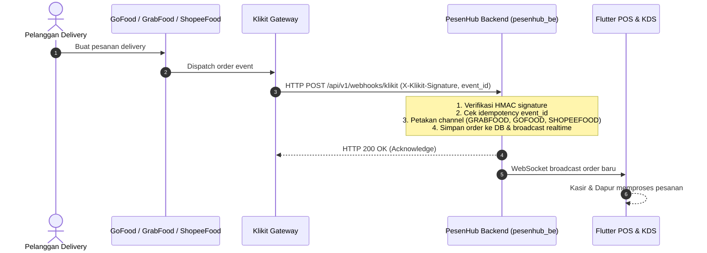

# Panduan Onboarding & Integrasi Klikit Partner API (Online Food Delivery Aggregator)

Dokumen ini adalah panduan teknis dan operasional untuk pengajuan akses, arsitektur integrasi, dan pengujian sandbox **Klikit Partner API** sebagai *third-party aggregator* pesanan online food delivery (**GoFood, GrabFood, ShopeeFood**) pada ekosistem **PesenHub**.

Referensi:
- **Parent Epic:** [#1](https://github.com/yogaananda6677/pesanhub/issues/1)
- **Parent Phase:** [#7 — Phase 2 Food Aggregator Integration](https://github.com/yogaananda6677/pesanhub/issues/7)
- **Task Issue:** [#216 — Pengajuan akses partner API dan sandbox Klikit](https://github.com/yogaananda6677/pesanhub/issues/216)
- **PIC / Assignee:** @zakkiyahkarimah-sketch (Karimah)
- **Lead Engineer / Backend Team:** @yogaananda6677

---

## 1. Latar Belakang & Keputusan Arsitektur (ADR-016)

### 1.1 Masalah Integrasi Mandiri (Direct Provider)
Menghubungkan POS langsung ke masing-masing provider (*Gojek GoBiz API*, *GrabFood Merchant API*, dan *ShopeeFood Partner API*) memiliki kendala operasional yang sangat besar:
1. **Birokrasi & Legalitas Terpisah:** Setiap provider mewajibkan pendaftaran korporasi, NDA, penandatanganan kontrak kemitraan terpisah, dan verifikasi entitas bisnis bertingkat.
2. **Maintenance 3 Adapter Berbeda:** Format payload webhook, mekanisme autentikasi (OAuth2, signature header), siklus hidup status order, dan format katalog menu berbeda secara signifikan di tiap platform.
3. **Keterbatasan Sandbox Developer:** Sebagian provider delivery lokal tidak menyediakan environment sandbox publik untuk pengembang independen tanpa volume transaksi besar yang sudah aktif.

### 1.2 Solusi Menggunakan Klikit
PesenHub memilih **Klikit** ([klikit.io](https://www.klikit.io)) sebagai mitra agregator tunggal untuk Phase 2:
- **Unified Webhook & REST API:** Klikit menstandarkan pesanan dari GoFood, GrabFood, dan ShopeeFood ke dalam satu skema payload webhook (`klikit.order.created.v2`).
- **Single Integration Touchpoint:** Backend PesenHub (`pesenhub_be`) hanya perlu membangun satu adapter webhook receiver yang aman.
- **Dedicated Sandbox & Simulator:** Klikit menyediakan Mock Store dan Dashboard Test untuk mensimulasikan pemesanan delivery tanpa harus membakar biaya pesanan nyata.

---

## 2. Panduan Pengajuan Akses Partner API (Action Items PIC)

Pengajuan kemitraan Klikit bersifat **by-invitation / partner approval** (tidak ada pendaftaran instan self-service). PIC (@zakkiyahkarimah-sketch) wajib mengajukan permohonan melalui salah satu atau kedua jalur resmi berikut:

### 2.1 Jalur Pengajuan Resmi
1. **Formulir Website Resmi:**
   - Kunjungi [https://www.klikit.io](https://www.klikit.io)
   - Navigasi ke menu **Partner API** atau **Integrations**
   - Klik tombol **"Become a Partner"** atau **"Get in Touch"**
2. **Email Langsung:**
   - Kirimkan email resmi ke: **`integrations@klikit.io`**
   - Carbon Copy (CC): **`yogaanandaxx1212@gmail.com`**

### 2.2 Data Profil Entitas PesenHub
Saat mengisi formulir atau melengkapi tanya-jawab dari tim Klikit, gunakan data standar berikut:
- **Company / Product Name:** PesenHub
- **Contact Person:** Karimah
- **Role:** Product / Integration Coordinator
- **Business Category:** Cloud Point-of-Sale (POS), Kitchen Display System (KDS) & Order Management System for F&B
- **Operating Region:** Indonesia (ID)
- **Target Integrations:** GoFood (Gojek), GrabFood, ShopeeFood
- **Initial Deployment Scope:** Tahap pilot / MVP rollout untuk outlet mitra F&B (Outlet Martabak & Terang Bulan di Jawa Timur, Indonesia)
- **Technical Capability:** Cloud Backend (Golang REST & Webhooks), Mobile POS (Flutter), Real-time WebSocket Order Queue

---

## 3. Template Korespondensi Resmi

### 3.1 Draf Email Bahasa Indonesia (Utama)

**Subject:** `Permohonan Kemitraan & Akses Sandbox Partner API - PesenHub POS Integration`

```text
Yth. Tim Kemitraan & Integrasi Klikit,

Salam hangat,
Saya Karimah dari tim PesenHub, penyedia solusi Point-of-Sale (POS) dan Kitchen Display System (KDS) berbasis cloud untuk pelaku usaha F&B di Indonesia.

Saat ini kami sedang mengembangkan integrasi otomatis pemesanan online food delivery agar pesanan dari platform GoFood, GrabFood, dan ShopeeFood dapat langsung masuk secara real-time ke aplikasi kasir dan layar antrean dapur outlet mitra kami. Kami tertarik untuk menggunakan solusi Klikit Partner API & Inbound Webhooks sebagai agregator terpadu.

Sehubungan dengan kebutuhan pengujian dan pengembangan teknis sistem kami, kami ingin mengajukan permohonan akses untuk:
1. Akun pengembang pada Klikit Partner Portal (portal.klikit.io).
2. Akses ke Sandbox / Staging Environment beserta mock store simulator untuk pengujian webhook pesanan.
3. Dokumentasi teknis lengkap mengenai Inbound Order Webhooks, spesifikasi payload JSON, skema autentikasi HMAC signature, dan sinkronisasi status order.

Mohon informasi mengenai prosedur atau dokumen persyaratan yang perlu kami lengkapi untuk proses onboarding mitra ini. Kami siap untuk berdiskusi lebih lanjut via email maupun panggilan daring.

Terima kasih atas perhatian dan kerja samanya.

Hormat kami,
Karimah
Product & Integration Coordinator — PesenHub
Email: (email PIC)
CC: yogaanandaxx1212@gmail.com
```

### 3.2 Draf Email Bahasa Inggris (Alternatif / Tim Global Klikit)

**Subject:** `Partnership & Sandbox API Access Request - PesenHub POS Integration`

```text
Dear Klikit Partnership & Integrations Team,

Warm greetings from PesenHub!
I am Karimah, Product & Integration Coordinator at PesenHub. We build cloud Point-of-Sale (POS) and Kitchen Display Systems (KDS) for food and beverage outlets in Indonesia.

We are currently building automated delivery order ingestion so that orders placed via GoFood, GrabFood, and ShopeeFood flow directly into our unified cashier and kitchen display screens in real-time. We are excited about partnering with Klikit to leverage your unified Partner API and webhook infrastructure.

In order to prepare and validate our technical integration, we would like to request:
1. Developer account access to the Klikit Partner Portal (portal.klikit.io).
2. Access to the Sandbox / Staging Environment and mock store order simulator.
3. Complete technical specifications for Inbound Order Webhooks (JSON payload structures, HMAC webhook signature verification, and order status sync).

Please let us know the onboarding steps or any prerequisites required from our end. We look forward to collaborating with the Klikit team.

Best regards,
Karimah
Product & Integration Coordinator — PesenHub
CC: yogaanandaxx1212@gmail.com
```

---

## 4. Artefak Wajib yang Harus Didapatkan dari Klikit

Setelah permohonan disetujui, PIC wajib mengamankan dan mendokumentasikan artefak teknis berikut:

| No | Artefak | Deskripsi | Tujuan |
|---|---|---|---|
| 1 | **Sandbox Base URL** | Endpoint REST Klikit Staging (misal: `https://api.staging.klikit.io/v2`) | Pengujian query detail pesanan |
| 2 | **API Credentials** | `client_id`, `client_secret`, dan `api_key` staging | Autentikasi panggilan REST API |
| 3 | **Webhook Secret** | Secret key untuk HMAC-SHA256 signature verification | Validasi integritas & keaslian webhook masuk |
| 4 | **Spesifikasi Webhook** | Dokumentasi resmi event `klikit.order.created.v2` | Verifikasi mapping JSON domain order |
| 5 | **Akses Mock Simulator** | Portal test untuk mentrigger pesanan dummy | Validasi end-to-end tanpa transaksi nyata |

> [!CAUTION]
> **Kebijakan Keamanan Kredensial:**
> Dilarang keras mencatat `client_secret`, `api_key`, atau `webhook_secret` di GitHub issue, commit Git, atau file publik. Simpan kredensial secara lokal pada file `.env` di `pesenhub_be/` yang telah di-ignore oleh Git, atau gunakan secret manager.

---

## 5. Spesifikasi Teknis Integrasi Webhook (Preview)

### 5.1 Siklus Alur Webhook


### 5.2 Skema Keamanan & Idempotensi
1. **Verifikasi Signature (HMAC-SHA256):**
   Setiap webhook yang masuk menyertakan header tanda tangan (misal: `X-Klikit-Signature`). Backend PesenHub menghitung HMAC-SHA256 dari raw request body menggunakan webhook secret terkonfigurasi:
   $$\text{computed\_sig} = \text{HMAC-SHA256}(\text{raw\_body}, \text{secret})$$
   Jika signature tidak cocok, kembalikan `HTTP 401 Unauthorized` dan tolak pemrosesan.
2. **Idempotensi Dua Tahap:**
   Header `X-Idempotency-Key` atau field `event_id` dicatat ke tabel deduplikasi. Jika event dengan ID yang sama diterima kembali (akibat retry dari Klikit), backend langsung mengembalikan `HTTP 200 OK` tanpa membuat order ganda.

### 5.3 Pemetaan Domain Sumber Pesanan (Channel Mapping)
Field `channel` dari payload Klikit dipetakan langsung ke enum domain `OrderSource` di `pesenhub_be/internal/domain/types.go`:
- `"grabfood"` $\rightarrow$ `domain.OrderSourceGrabFood` (`"GRABFOOD"`)
- `"gofood"` $\rightarrow$ `domain.OrderSourceGoFood` (`"GOFOOD"`)
- `"shopeefood"` $\rightarrow$ `domain.OrderSourceShopeeFood` (`"SHOPEEFOOD"`)

### 5.4 Contoh Struktur Payload Canonical (`klikit.order.created.v2`)
Spesifikasi payload acuan tersedia di:
[`docs/api/fixtures/klikit_order_created_v2.json`](file:///home/yoga/Data/Kuliah/PTT_app/docs/api/fixtures/klikit_order_created_v2.json)

```json
{
  "event": "klikit.order.created.v2",
  "event_id": "evt_klikit_20261106_9f83a",
  "created_at": "2026-11-06T15:30:00Z",
  "data": {
    "order_id": "klikit_ord_88291039",
    "channel": "grabfood",
    "channel_order_id": "GF-20261106-9912",
    "status": "PLACED",
    "order_type": "DELIVERY",
    "currency": "IDR",
    "amounts": {
      "subtotal": 55000,
      "delivery_fee": 12000,
      "total": 67000
    },
    "customer": {
      "name": "Budi Santoso",
      "phone": "+628123456789"
    },
    "items": [
      {
        "item_id": "mt-spesial-01",
        "name": "Martabak Telur Spesial Daging Sapi",
        "quantity": 1,
        "unit_price": 55000,
        "total_price": 55000,
        "modifiers": [
          {
            "modifier_group": "Level Pedas",
            "option_name": "Sedang",
            "price": 0
          }
        ]
      }
    ],
    "notes": "Tolong kuah cukanya dipisah dan ditambah acar timun."
  }
}
```

---

## 6. Checklist Pelacakan Onboarding (#216)

Gunakan checklist ini untuk memantau status kemajuan pengerjaan Issue #216:

- [ ] **Langkah 1: Pengiriman Permohonan**
  - PIC mengirim formulir via [klikit.io](https://www.klikit.io) atau email ke `integrations@klikit.io` (CC: `yogaanandaxx1212@gmail.com`).
  - Tanggal pengiriman dicatat.
- [ ] **Langkah 2: Konfirmasi & Respon Klikit**
  - Respon pertama dari tim kemitraan Klikit diterima dan dicatat statusnya (disetujui / ada kuesioner onboarding lanjutan).
- [ ] **Langkah 3: Penerimaan Kredensial Sandbox**
  - Akun pengembang pada Partner Portal aktif.
  - Kredensial staging (`client_id`, `client_secret`, `api_key`, `webhook_secret`) diterima dan disimpan di `.env` lokal tim.
- [ ] **Langkah 4: Serah Terima Teknis**
  - Dokumentasi resmi webhook dan akses simulator diserahkan ke Lead Engineer / tim Backend.
  - Issue #216 ditutup, membuka jalan implementasi adapter di Phase 2 (#7 / #62 / #63).
